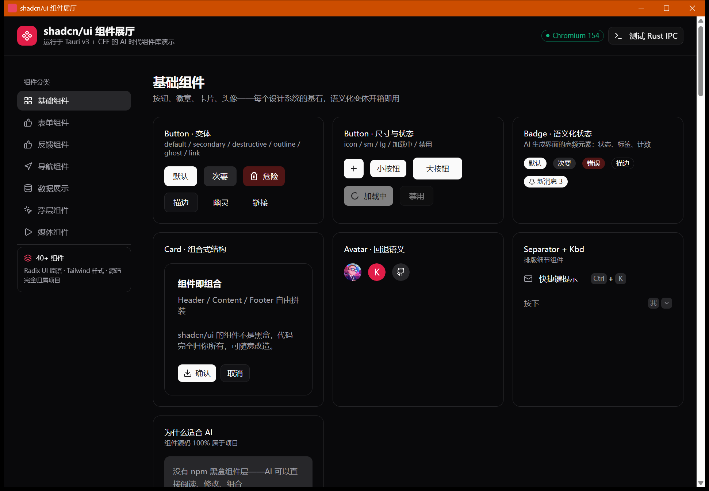
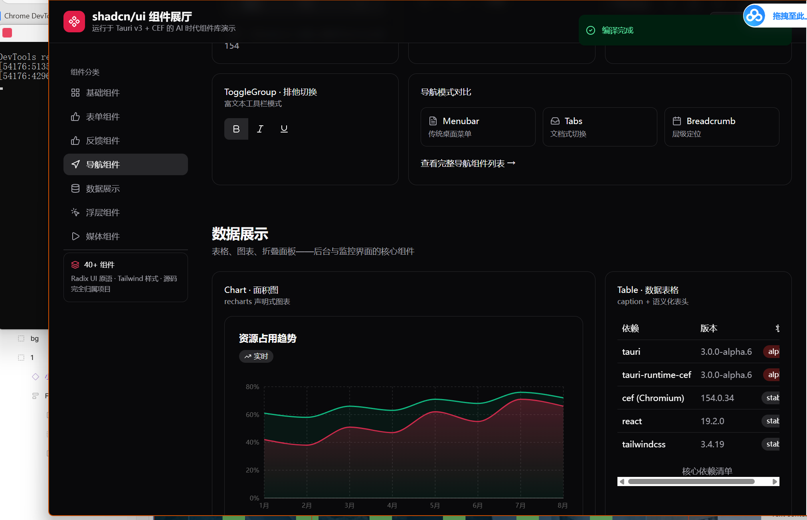
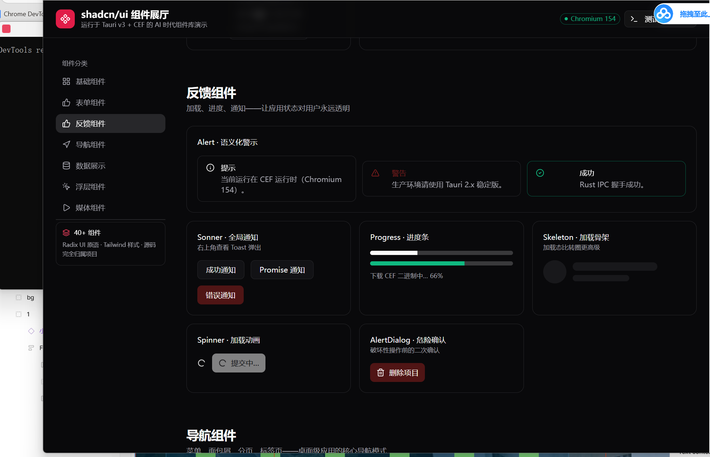
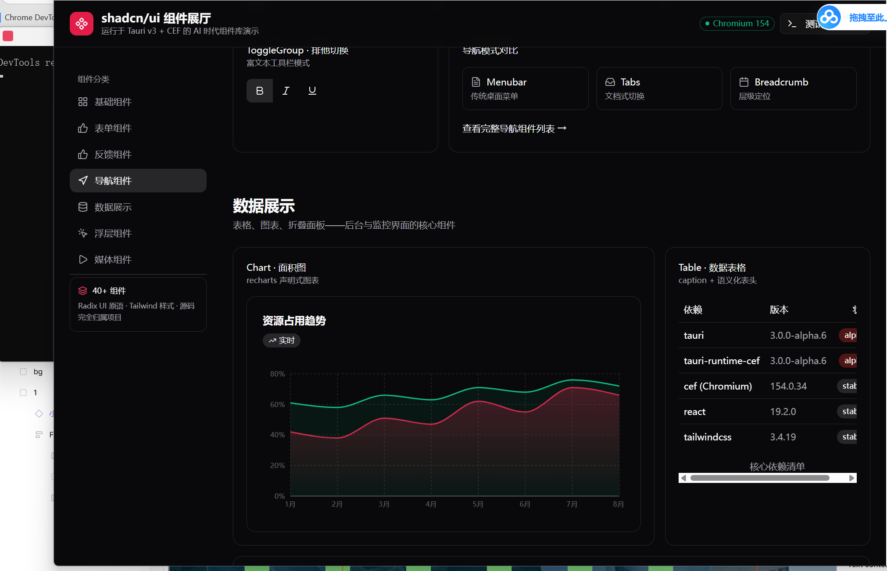
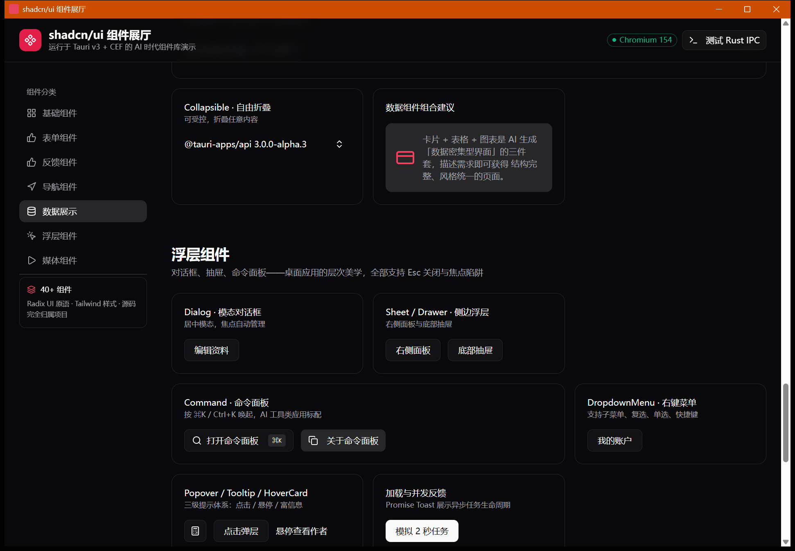
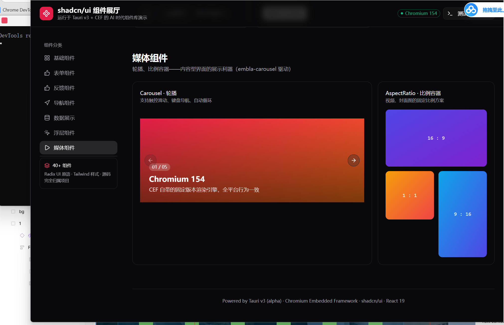

# shadcn/ui 组件展厅 · Tauri v3 CEF Demo

基于 **Tauri v3（alpha）+ CEF 运行时**的 shadcn/ui 组件展厅：React 19 + Tailwind + 40+ 组件活体演示，Rust 后端 IPC 互通。

## 这是什么

一个跑在 **Tauri v3 + CEF** 里的 shadcn/ui 全组件活体展厅。渲染引擎为随应用分发的 Chromium Embedded Framework（Chromium 154），而非系统 WebView——所有组件在所有平台上渲染行为完全一致。

选 shadcn/ui 的理由：组件源码 100% 归属项目（无 npm 黑盒层），AI 可以直接阅读、修改、组合，是 AI 生成界面时代正确率最高的组件体系。

## 功能特性

- **CEF 运行时**：使用 Tauri v3 新的运行时模型，显式选择 `tauri-runtime-cef`，自带固定版本 Chromium 154，彻底消除系统 WebView 差异
- **7 大组件分类、40+ 组件活体展示**：
  - 基础组件：Button / Badge / Card / Avatar / Separator / Kbd
  - 表单组件：Input / Textarea / Select / Checkbox / Radio / Switch / Slider / Calendar
  - 反馈组件：Alert / Sonner / Progress / Skeleton
  - 导航组件：Menubar / Tabs / Breadcrumb / Toggle Group
  - 数据展示：Table / Chart（recharts）/ Accordion / Collapsible
  - 浮层组件：Dialog / Sheet / Command 命令面板 / DropdownMenu / Popover / Tooltip / HoverCard
  - 媒体组件：Carousel（embla）/ AspectRatio
- **⌘K 命令面板**：AI 工具类应用标配，支持键盘唤起与全文检索
- **Rust ↔ 前端 IPC**：一键测试 Rust 命令调用（`greet`）

## 运行截图













## 技术架构

| 层 | 技术 |
|---|---|
| 桌面框架 | Tauri 3.0.0-alpha + tauri-runtime-cef |
| 渲染引擎 | CEF（Chromium 154，随应用分发） |
| 前端 | React 19 · TypeScript · Vite 7 |
| UI | Tailwind CSS 3 · shadcn/ui（Radix UI 原语，40+ 组件） |
| 图表 / 轮播 | recharts · embla-carousel |
| 包管理 | pnpm |

## 开发

```bash
pnpm install
pnpm tauri dev        # 启动 Vite 开发服务器 + CEF 应用（热更新）
```

## 构建

```bash
pnpm build            # 前端产物 → dist/
pnpm tauri build      # 完整安装包（NSIS）
```

> 注意：`cargo run` / `cargo build` 单独运行时处于 dev 模式，会尝试连接 `devUrl`（http://localhost:1420），需要先用 `pnpm dev` 起前端；正式产物请走 `pnpm tauri build`。

## 目录结构

```
src/                 React 前端（展厅页面、shadcn 组件、⌘K 命令面板）
src/components/showcase/  展厅分区（基础/表单/反馈/导航/数据/浮层/媒体）
src-tauri/           Rust 后端（greet 命令、CEF 运行时入口）
docs/screenshots/    运行截图
```

## 环境要求

- Rust ≥ 1.95
- Node.js ≥ 20 + pnpm
- Windows：Visual Studio C++ 构建工具、CMake、Ninja（首次构建自动下载 CEF 二进制，约 280 MB）

## 相关背景

- Tauri v3 升级动机：Linux 端 GTK/glib 旧版本存在内存安全问题且上游已停止维护，v3 借机将运行时拆分为独立 crate（含 `tauri-runtime-cef`），一批破坏性变更被打包进大版本。
- CEF vs 系统 WebView 的权衡：CEF 解决渲染引擎一致性，但包体积增大、不支持 iOS / Android，操作系统层面的差异（文件系统、窗口行为）依然存在。
